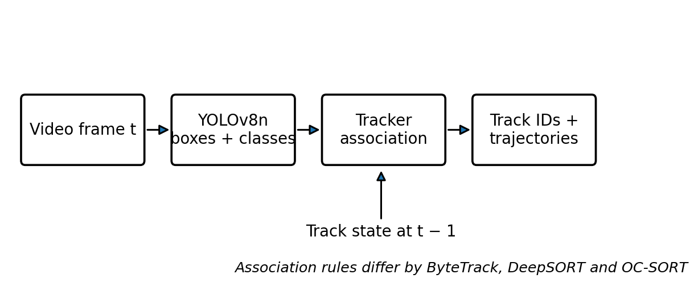
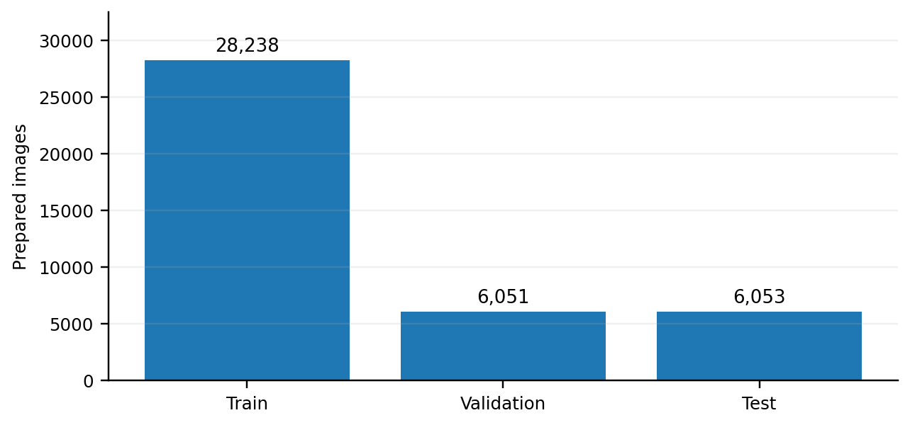
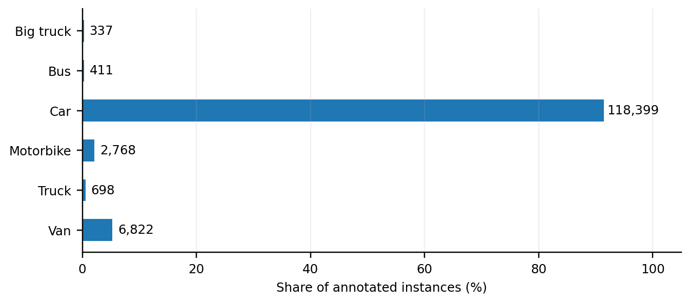
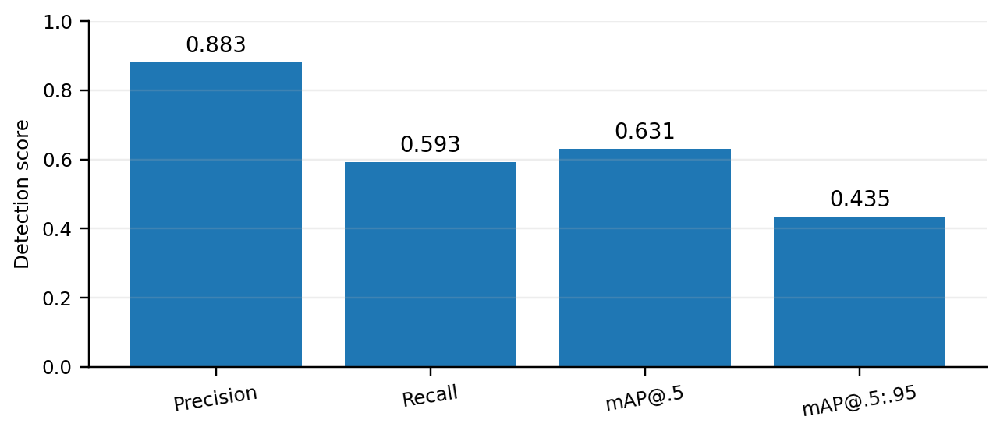
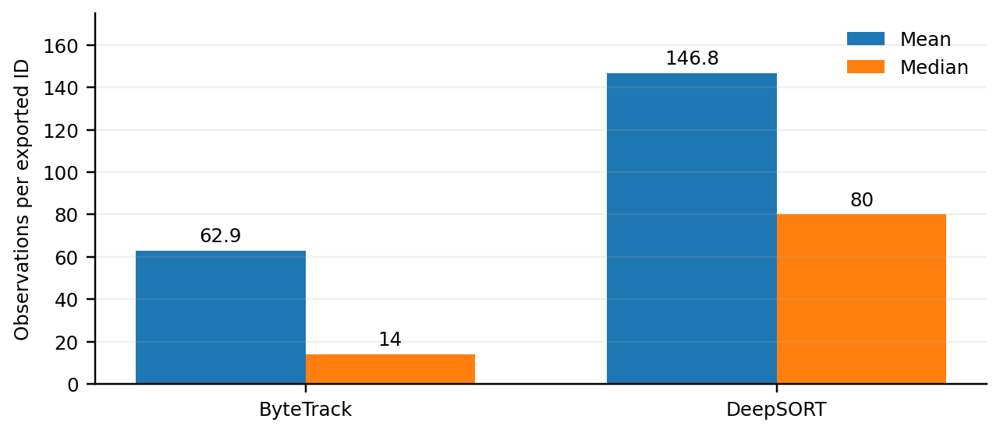

# YOLOv8n-Based Multi-Object Tracking for Real-Time Traffic Monitoring

**7th Semester B.Tech Minor Project | Computer Engineering (AI & ML) | Silver Oak University**

An AI-based traffic-monitoring pipeline that detects vehicles using **YOLOv8n** and examines multi-object tracking with **ByteTrack, DeepSORT, and OC-SORT**. The project covers GRAM dataset preparation, detector training and validation, video tracking, and comparison of exported tracking diagnostics.

> **Repository status:** This repository packages the project scripts and figures recovered from the supplied project files. The original recorded traffic video, full GRAM dataset, and the trained `best.pt` checkpoint are **not included**. Two tracking runners were adapted for portable command-line use; they have passed Python syntax checks but have **not** been end-to-end tested in this package. See [Reproducibility notes](#reproducibility-notes).

## Project overview

The system processes traffic footage in the following stages:

1. Prepare GRAM images and XML annotations in YOLO format.
2. Train a YOLOv8n detector on six vehicle categories.
3. Detect vehicles in video frames.
4. Associate detections across frames using tracking algorithms.
5. Save annotated tracking videos and frame/track-level outputs for analysis.



### Vehicle classes

`Big-truck`, `Bus`, `Car`, `Motorbike`, `Truck`, `Van` (six classes in the prepared GRAM data).

## Technologies

- **Language:** Python
- **Object detection:** Ultralytics YOLOv8n / PyTorch
- **Tracking:** ByteTrack, DeepSORT (`deep-sort-realtime`), OC-SORT (separate integration required)
- **Image/video processing:** OpenCV, Pillow
- **Data processing and visualization:** NumPy, pandas, Matplotlib, PyYAML

## Recorded project results

The following values are taken from the project's report; they are not newly computed by this repository package.

| Detector metric | Recorded value |
| --- | ---: |
| Prepared GRAM images | 40,342 |
| Training / validation / testing images | 28,238 / 6,051 / 6,053 |
| Annotated vehicle objects | 129,435 |
| Training epochs | 50 |
| Precision | 0.883 |
| Recall | 0.593 |
| mAP@0.5 | 0.631 |
| mAP@0.5:0.95 | 0.435 |

Tracking diagnostics on a separately recorded traffic video:

| Tracker | Recorded output | Important context |
| --- | --- | --- |
| ByteTrack | 123,918 tracked observation rows; 1,969 output IDs | 28,365 frames represented in export |
| DeepSORT | 223,094 tracked observation rows; 1,520 output IDs | 28,866 frames represented in export |
| OC-SORT | 20,988 detections; 717 output IDs | Every other video frame sampled (14,486 sampled frames) |

**Interpretation:** These are output counts and processing diagnostics, **not** tracking-accuracy scores. OC-SORT used a different frame-sampling schedule, so direct count-based ranking is not valid. No ground-truth-aligned MOTA, IDF1, HOTA or ID-switch comparison was established for the separately recorded video. The reported OC-SORT detector-only speed was 44.23 FPS, versus approximately 7.50 sampled FPS for its end-to-end pipeline.

## Project figures

| Dataset split | Vehicle class distribution |
| --- | --- |
|  |  |

| YOLOv8n detection performance | Tracking statistics |
| --- | --- |
|  |  |

These five PNG figures are included in the [`Project_Figures/`](Project_Figures/) folder and were extracted from the supplied project report. They are not screenshots of live vehicle detections. Download the folder along with this README so GitHub can display them.

## Repository structure

```text
.
├── README.md
├── .gitignore
├── .gitattributes
├── requirements.txt
├── Project_Figures/            # Five PNG figures from the project report
├── configs/
│   └── bytetrack_gram.yaml
├── datasets/
│   └── README.md               # Dataset acquisition and layout guidance
├── scripts/
│   ├── prepare_gram.py
│   ├── validate_yolo_labels.py
│   ├── visualize_yolo_labels.py
│   ├── train_baseline_test.py
│   ├── test_baseline_predictions.py
│   ├── run_bytetrack.py       # Portable command-line adaptation
│   ├── run_deepsort.py        # Portable command-line adaptation
│   ├── run_ocsort.py          # Original script; needs OC-SORT integration
│   └── original/              # Unmodified tracking scripts from the archive
└── tools/                     # GRAM inspection and conversion helpers
```

## Installation

Use a recent Python environment compatible with your PyTorch and Ultralytics versions. GPU acceleration is recommended for training.

```bash
git clone https://github.com/YOUR_USERNAME/YOUR_REPOSITORY.git
cd YOUR_REPOSITORY
python -m venv .venv
```

Activate the environment:

```bash
# Windows PowerShell
.venv\Scripts\Activate.ps1

# macOS / Linux
source .venv/bin/activate
```

Install dependencies:

```bash
pip install -r requirements.txt
```

For GPU use, install a PyTorch build appropriate to your CUDA setup. Versions were not pinned in the supplied source archive; exact environment reproduction may require matching the original installation.

## Dataset preparation

The original project uses the **GRAM road-traffic dataset** with `M-30`, `M-30-HD` and `Urban1` subsets. Download the dataset from an authorized source; do not commit the raw images or XML files unless redistribution is permitted.

Place files as described in [`datasets/README.md`](datasets/README.md), then run:

```bash
python scripts/prepare_gram.py
python scripts/validate_yolo_labels.py
python scripts/visualize_yolo_labels.py
```

The preparation script writes `prepared_data/GRAM/data.yaml`, YOLO images/labels, class mapping, and tracking annotation CSV. The output directory is excluded by `.gitignore` because it contains a large derived dataset.

## Model training

The original training script uses the pretrained **YOLOv8n** model, 50 epochs, 640-pixel input, batch size 2, and CUDA device `0`:

```bash
python scripts/train_baseline_test.py
```

It expects `prepared_data/GRAM/data.yaml`. It saves checkpoints under:

```text
results/training/baseline_yolov8n_50epochs/weights/best.pt
```

**CPU-only users:** Edit the `device=0` argument in the training script to `device="cpu"` before running. Training will be substantially slower.

After training, generate test predictions:

```bash
python scripts/test_baseline_predictions.py
```

## Run tracking on your own video

Supply your own video and your **trained** `best.pt` checkpoint. A standard pretrained COCO YOLOv8n checkpoint is **not equivalent** to the six-class model reported here.

### ByteTrack

```bash
python scripts/run_bytetrack.py --weights "path/to/best.pt" --video "path/to/traffic_video.mp4"
```

Optional: `--tracker configs/bytetrack_gram.yaml` to use the supplied ByteTrack configuration. The portable runner writes an annotated MP4 and a CSV under `results/tracking/bytetrack/` by default.

### DeepSORT

```bash
python scripts/run_deepsort.py --weights "path/to/best.pt" --video "path/to/traffic_video.mp4"
```

This runner uses `deep-sort-realtime` and writes an annotated MP4 and a CSV under `results/tracking/deepsort/`.

### OC-SORT

The archived `scripts/run_ocsort.py` is preserved for completeness, but it uses an **absolute Windows project path** and passes `tracker="ocsort.yaml"` to Ultralytics. That tracker YAML and the required custom tracker registration/integration are **not present** in the supplied archive. It is **not ready to run unchanged** in a fresh environment. Install and configure a compatible OC-SORT integration before attempting to reproduce the original run.

## Reproducibility notes

- The portable ByteTrack and DeepSORT runners are convenience adaptations of the original project scripts; the unmodified originals are in `scripts/original/`.
- The original `scripts/run_ocsort.py` is included unchanged and requires extra setup as noted above.
- The source archive also contained third-party clones of ByteTrack, DeepSORT and OC-SORT. Those entire upstream repositories (including nested `.git` folders and demonstration media) were intentionally **not** copied into this repository. Use the original upstream projects and comply with their licenses if integrating their code.
- This package includes **no trained six-class checkpoint**, original GRAM data, tracking CSV exports, or actual vehicle-tracking output videos. Add only files you own or are authorized to distribute.
- The reported comparison uses unequal frame sampling for OC-SORT and lacks identity-annotated ground truth for the personal video. Avoid claims of a verified best tracker.
- Attention mechanisms and adaptive tracker selection are potential future enhancements, **not implemented features** in the archived code.

## Project context and credits

Developed as a **7th-semester Minor Project** in Computer Engineering (Artificial Intelligence & Machine Learning), Silver Oak University. Project contributors: **Jeet Gajjar, Darsh Amin, and Varun Rochwani**. Faculty guide: **Prof. Sanket Shah**.

The implementation builds on Ultralytics YOLO, ByteTrack, DeepSORT, and OC-SORT, and uses the GRAM road-traffic dataset. Credit the original maintainers and dataset creators when publishing derived work. No license for this student's original project code has been selected here; add a `LICENSE` file only after the contributors agree on one.
